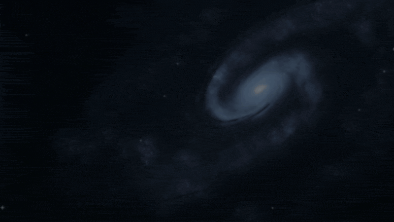

# Pale Blue Flame

*Nobody has lit a fire there yet.*



**[Live site](https://mtaimourz.github.io/pale-blue-flame/)** · **[Demo video (29 s)](https://drive.google.com/file/d/1_hw8IykJUlofG4zQl76rkk30fFltZF2W/view?usp=sharing)** · **[Data exploration notebook](notebooks/01_explore_the_data.ipynb)** · **[Data cleaning notebook](notebooks/02_clean_the_data.ipynb)**

## Why we built it

NASA has run 263 material fire tests in space. A sheet of cotton and fiberglass, almost a meter long, burned on a cargo ship after it left the Space Station. And every one of those fires burned in the same kind of air: Space Station air, normal pressure, 14 to 22% oxygen.

The places people will live next are a bit different from where these tests ran. NASA plans Moon and Mars bases at 34% oxygen and 0.56 atm, and no material fire in our data comes near that air. One NASA investigation, ACME BRE, records flames that kept burning without airflow in air like that. In normal 21% air, the same flames went out.

So we built one page that asks one question: **would this burn here?** It sounds like a small answer. Turns out it is the finding.

*Made for the NASA Space Apps Challenge 2026, challenge [Flame in Freefall](https://www.spaceappschallenge.org/2026/challenges/flame-in-freefall/).*

## The two answers

Select a material and a place, or ask about an object in your own words ("would my running shoe burn in a Moon rover?").

| Verdict | What it means |
|---|---|
| **NASA tested this.** | Real fires with that material burned in air like the air of that place. A tested material is not necessarily safe. The experiment page shows the result of each fire. |
| **We don't know. No matching test.** | NASA tested the material, but only in different air. A material without a test is not necessarily safe. |

## What is on the page

| Part | What it shows |
|---|---|
| First screen | The verdict, the places (Earth, Space Station, spacewalk, Moon, Mars) and the oxygen chart. Each blue dot is a real NASA fire. The diamond is the air of your place. |
| *The gap* tab | Each material fire by oxygen and cabin pressure, with the places where people plan to live. |
| *Experiments* tab | The 24 investigations, in order of importance for your place, in three groups: prevent, detect, suppress. You can compare two. |
| *A real fire* tab | The four heat sensors of Saffire-I, shown again in time order. |
| *Back on Earth* tab | Space fire-safety technologies that people now use on Earth. |
| *The data* tab | The tests for each material, as a chart, a table and a CSV file. |
| Ask bar | Your own question. It stays at the bottom of the screen. |

To read a value, move the pointer across a chart. To open an experiment, click its dot.

## How it works

- **Data.** The source is the Combustion Science records of [NASA Physical Sciences Informatics](https://psi.nasa.gov/physci/repo/search?q=combustion) (24 investigations, 23 with the CC0-1.0 license). Two notebooks change their test tables into one table of 263 material tests. The air of each place comes from NASA technical reports (links in `data/places.json`).
- **AI.** The AI does one task: it identifies the materials of an object, for example "a plastic shroud, a circuit board, a metal heatsink". A fixed table in our code then selects the nearest material that NASA tested. The verdict, the numbers and the charts come from NASA's data, not from the AI.
- **Summaries.** The AI also wrote the experiment summaries from the NASA records. Each line shows its source in the record. Our code removed each line without a real source.
- **Checks.** `backend/eval_cases.py` sends 14 everyday questions to the backend and checks the answers.

| Folder | Contents |
|---|---|
| `notebooks/` | Data exploration (01) and data cleaning (02). |
| `data/` | The files that the site reads. |
| `webapp/` | The website: Vue 3, Vite, SVG and D3. |
| `backend/` | The question service: FastAPI and LangGraph, with DeepSeek. |
| `docs/` | The demo GIF. |

## Run it

**The site** (Node 18 or later):

```sh
cd webapp
npm install
npm run dev
```

Open `http://localhost:5173`. The site operates without a network connection.

**The question box** (Python 3.11 or later, [uv](https://docs.astral.sh/uv/), a DeepSeek API key). In a second terminal:

```sh
cd backend
export DEEPSEEK_API_KEY=your-key
uv run uvicorn app:app --port 8787
```

> **Keep the key in the backend. Do not put the key in the website.**
> If the backend stops, the question box shows a message. The other parts of the site continue to operate.

**A stand at an event:** open `http://localhost:5173/?stand=1#/burn` and set the browser to full screen. The page shows a new example each six seconds.

**Publish online:** run `webapp/scripts/deploy-pages.sh`. GitHub Pages gets the site from the `gh-pages` branch. The online copy has no backend: its five example questions use saved answers (`data/answers.json`).

## Limits

- NASA's tables do not record the pressure of the material tests. We use cabin pressure (approximately 1 atm).
- "No matching test" applies only to the data that we used.
- The air for the Moon, the rover and Mars is a proposal. Real missions can be different.
- The Moon base and the rover pictures are NASA concept art. The galaxy background is a drawing, not a photograph.
- **Read the AI summaries before you quote them.**

---

We know a great deal about fire in one kind of air, and almost nothing about the air we are about to live in.
